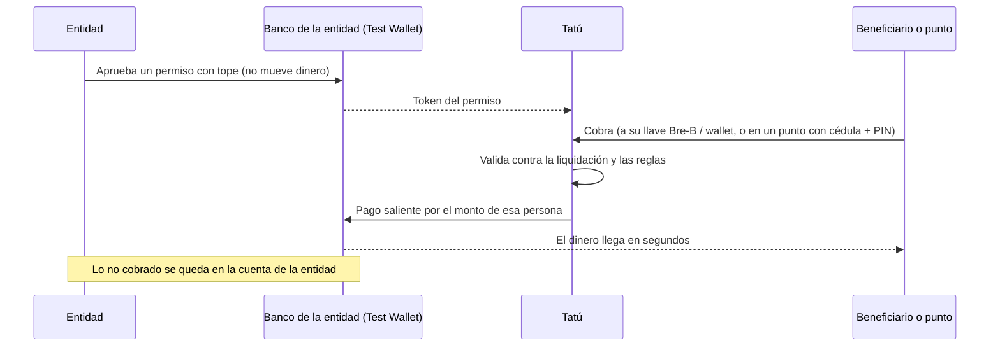
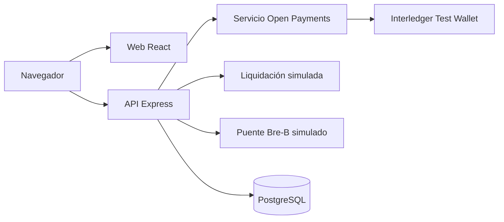

<p align="center">
  <picture>
    <source media="(prefers-color-scheme: dark)" srcset="web/public/brand/tatu-logo-oscuro.svg">
    
  </picture>
</p>

<p align="center">
  <strong>Subsidios que se cobran cuando la gente los necesita, no antes.</strong><br>
  Pagos bajo demanda con <a href="https://openpayments.dev">Open Payments</a> (Interledger).
</p>

---

## Qué es Tatú

Tatú es la capa de distribución que convierte una **liquidación ya aprobada** (quién recibe y
cuánto) en **pagos bajo demanda**.

### El problema

Hoy el Estado le gira al operador **todo el subsidio antes del ciclo**. El operador reparte la plata
a sus puntos, la gente tiene una ventana fija para cobrar y lo que nadie cobra se reintegra días
después. El dinero se mueve antes de que alguien lo necesite, y los puntos tienen que tener efectivo
por adelantado.

### Lo que cambia Tatú

1. **La entidad aprueba una sola vez**, en su banco, un permiso con tope. Aprobarlo **no mueve
   dinero**.
2. **Cada beneficiario cobra cuando quiere**: a su llave Bre-B (o a una wallet Open Payments), o en
   efectivo en un punto con su cédula y un PIN.
3. **El punto recibe el reembolso en el mismo momento** en que entrega el efectivo. Nunca pone plata
   por adelantado.
4. **Lo que nadie cobra nunca salió** de la cuenta de la entidad.

> La entidad autoriza en su banco; Tatú no toca la plata hasta que alguien cobra.

### ¿Y Bre-B?

En Colombia casi nadie tiene una wallet Open Payments, pero sí una **llave Bre-B** (cédula, celular,
correo o @alias). Tatú cobra a esa llave. Tatú solo habla Open Payments: un **banco puente** resuelve
la llave a una wallet address. En la demo ese puente es **simulado**.

## Cómo se mueve la plata



El **banco** hace cumplir el tope, no la plataforma: si un pago lo supera, el banco lo rechaza.

## Quién usa Tatú

| Rol | Quién es en la demo | Qué hace |
|---|---|---|
| **Entidad** | El gobierno (la wallet que paga) | Crea el programa, aprueba el tope en su banco, ve el tablero, pausa y cierra |
| **Beneficiario** | Quien recibe el subsidio | Ve cuánto tiene, enlaza su llave o wallet, cobra o busca un punto |
| **Punto** | Un Efecty o un comercio | Digita la cédula, pide el PIN, entrega el efectivo y ve su caja |
| **Equipo** | Quien arma la demo | Registra personas, puntos, comercios y llaves Bre-B de prueba |

No hay cuentas de usuario: se entra **eligiendo un rol**. Es una decisión de la demo (ver
[Lo que no entra](#lo-que-no-entra)).

## Alcance

### Lo que entra (MVP de la demo)

- **Programa de subsidio** (destino libre): cobro a la cuenta y retiro en efectivo en un punto.
- **Un permiso con tope** (grant GNAP) aprobado en la Interledger Test Wallet; el token se rota
  antes de vencer y se puede renovar.
- **Pago Open Payments real**: incoming payment en el destino y outgoing payment con
  `debitAmount`.
- **Cobro a la cuenta** con un solo botón, sin PIN, a la llave Bre-B o a la wallet enlazada.
- **Cobro en el punto** con cédula y PIN de 4 dígitos: 120 s para confirmar; 3 intentos fallidos
  bloquean 15 minutos.
- **Un solo cobro por persona y programa** (idempotencia en la base, sin doble cobro).
- **Tablero de la entidad**: autorizado, cobrado y lo que nunca salió, con la línea de tiempo de
  cada cobro.
- **Ciclo de vida del programa**: Borrador → Esperando aprobación → Activo ⇄ Pausado → Cerrado
  (cerrar revoca el permiso).
- **Caja del punto** e **historial del beneficiario**.
- **Carga de personas** desde Excel o CSV.
- **Liquidación del gobierno simulada** (quién cobra, cuánto, PIN) y **banco puente Bre-B
  simulado** (llave → wallet). Tatú los consume por HTTP, como servicios de terceros.
- **Despliegue**: web y API en el mismo dominio, con HTTPS.

**Está listo cuando** hay un pago Open Payments completo y grabado: la entidad autoriza, alguien
cobra, el dinero llega y el tablero lo refleja.

### Si sobra tiempo (extras)

Se encienden con su variable `EXTRA_*` y no bloquean la entrega:

| Extra | Qué agrega |
|---|---|
| Bono con destino | Programa restringido a comercios verificados de ciertas categorías (alimentos, salud, educación). Paga `min(bono, total de la compra)` |
| QR del beneficiario | El punto escanea un QR temporal en lugar de digitar la cédula |
| PDF417 de la cédula | El punto lee el código de la cédula con la cámara o un lector 2D |
| Contrato por hitos | Liberar pagos cuando un supervisor certifica un hito |
| Despliegue público | Enlace abierto para el jurado |

### Lo que no entra

| Recorte | Por qué |
|---|---|
| Login, CORS, límite de pedidos | El evento dura menos de 24 h; el permiso del banco es la autorización que mueve la plata. El NIT y el PIN de la entrada de la entidad son de demostración y **no son control de acceso** |
| Varias entidades aisladas | En la demo hay una sola entidad; en producción habría tabla `entidad` y RLS por entidad |
| Carril Bre-B real | No hay API pública del directorio; el puente es simulado |
| Liquidación real de una entidad | Se consume por HTTP: reemplazar la simulada es cambiar una URL |
| App nativa | La demo cabe en el navegador |
| Cifrado de cédulas, KMS, fotos de identidad | Fuera del alcance del evento |

## Arquitectura en una mirada

Monolito modular: una app Node con la API y la web en el mismo dominio. El navegador **nunca**
habla con Open Payments ni guarda tokens; todo pasa por la API.



| Pieza | Elección |
|---|---|
| Runtime | Node 24, pnpm (workspace `web` + `server`) |
| API | Express 5, Zod 4 |
| Web | React 19, Vite, Tailwind 4, shadcn/ui |
| Pagos | `@interledger/open-payments` 7.4.0 |
| Datos | PostgreSQL (Supabase) con Drizzle; el esquema SQL está en `db/`. PGlite en local sin internet |
| Hosting | Vercel: estáticos + una función para `/api` |

## Estado del repositorio

El proyecto se construye durante el **Hackathon Interledger de Medellín (16 y 17 de octubre de
2026)**. Hoy el repositorio tiene el **backend** (`server/`), la documentación y la identidad visual;
la web (`web/`) es un esqueleto con el selector de rol.

```text
server/       API: Express + Zod + SDK Open Payments + Drizzle (Supabase o PGlite)
web/          Web: React + Vite + Tailwind CSS + shadcn/ui (esqueleto); web/public/brand: identidad visual
db/           Esquema SQL de la base de datos
docs/         Especificación, historias de usuario, arquitectura y prototipo
prompts/      Texto real de los prompts usados con IA
AI_USAGE.md   Uso de IA
```

## Cómo correrlo

Requisitos: Node.js LTS (ver `.nvmrc`) y pnpm (`corepack enable`).

```bash
cp .env.example .env   # completar; sin DATABASE_URL se usa PGlite local
pnpm install
pnpm dev               # API en :3000 y web en :5173 (Vite pasa /api a la API)
```

| Comando | Qué hace |
|---|---|
| `pnpm dev` | API (`server/`, Express + tsx) y web (`web/`, React + Vite) en paralelo |
| `pnpm test` | Vitest en todos los paquetes |
| `pnpm typecheck` | TypeScript en todos los paquetes |
| `pnpm build` | Typecheck de la API y build de la web |

### Documentación de la API

Con la API arriba: Swagger UI en <http://localhost:3000/api/docs> y el documento OpenAPI 3.1 en
`/api/openapi.json`. Para exportarlo a un archivo (Postman, Bruno):
`pnpm --filter server exec tsx scripts/volcar-openapi.ts`.

## Documentación

- [Especificación de implementación](docs/Especificación%20de%20implementación%20—%20Tatú.md):
  producto, reglas de negocio, estados, modelo de datos, API, pantallas y orden de trabajo.
- [Historias de usuario y criterios de aceptación](docs/HU-Criterios.md): backlog de 25 HU priorizadas
  (MoSCoW).
- [Estructura del proyecto](docs/Estructura%20del%20proyecto.md) y
  [Documento de Arquitectura](docs/Documento%20de%20Arquitectura%20—%20Hackathon%20Open%20Payments.md).
- [Prototipo](docs/Tatú%20·%20Prototipo.pdf) y [exploración de logo](docs/Tatú%20·%20Exploración%20de%20logo.pdf).

## Uso de IA

Ver [AI_USAGE.md](AI_USAGE.md) y la carpeta [prompts/](prompts/).

## Entregables del hackathon

Todo cierra el **sábado 17 de octubre a las 11:00**; desde ahí no se permiten cambios en el código.

- [ ] Repositorio público con todo en `main`; enlace enviado por el formulario de Slack.
- [ ] [`AI_USAGE.md`](AI_USAGE.md) en la raíz y [`/prompts`](prompts) con los prompts reales (se
  completan durante el evento).
- [ ] Presentación en la carpeta de Drive del equipo: _enlace pendiente_.
- [ ] Demo (video del flujo de pago): _enlace pendiente_.
