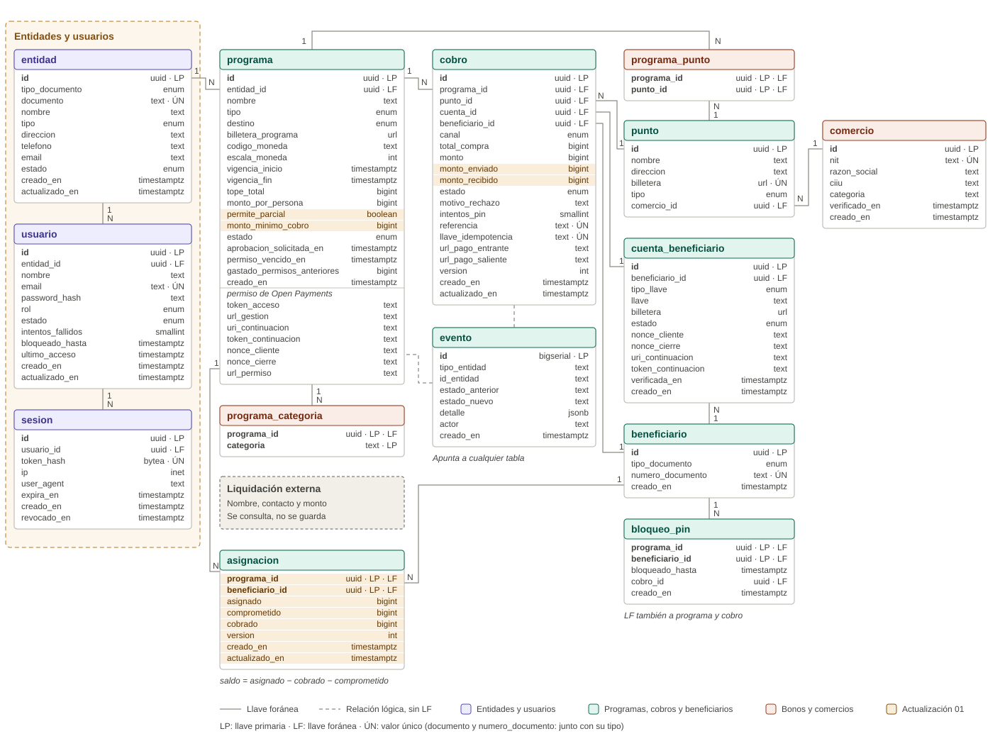

# Base de datos de Tatú

Modelo de datos de Tatú: la capa que convierte una liquidación ya aprobada en pagos bajo demanda con
Open Payments (Interledger). Este documento explica **toda** la base: para qué existe cada tabla,
qué guarda cada atributo, cómo se relacionan y qué reglas garantiza la propia base.



## Contenido

1. [Principio de diseño](#1-principio-de-diseño)
2. [Cómo montar la base](#2-cómo-montar-la-base)
3. [Convenciones](#3-convenciones)
4. [Tablas](#4-tablas)
5. [Estados](#5-estados)
6. [Qué garantiza la base](#6-qué-garantiza-la-base)
7. [Seguridad](#7-seguridad)
8. [Lo que no está en la base](#8-lo-que-no-está-en-la-base)
9. [Historias de usuario y tablas](#9-historias-de-usuario-y-tablas)
10. [Hallazgos y correcciones propuestas](#10-hallazgos-y-correcciones-propuestas)
11. [Actualización 01 · Cobros parciales de subsidios](#11-actualización-01--cobros-parciales-de-subsidios)

## 1. Principio de diseño

**Tatú es una pasarela.** El dinero no pasa por la plataforma: se mueve de billetera a billetera en
el banco (Open Payments). La base es la memoria de **por qué** se movió, **cuánto**, **hacia dónde**
y **si de verdad llegó**.

- La entidad (Colsubsidio, una alcaldía…) sigue decidiendo quién recibe y cuánto. Esa lista, la
  **liquidación**, vive en su sistema y se **consulta**; no se copia.
- De la persona solo se guarda lo que se verifica para la transacción: tipo y número de documento,
  y la cuenta (llave Bre-B o wallet) a la que se le paga.
- Nada con historial financiero se borra: cambia de estado.

## 2. Cómo montar la base

`esquema.sql` tiene dos partes:

| Parte | Qué hace | Dónde se ejecuta |
|---|---|---|
| **Script original** (desde el inicio hasta el primer `COMMIT`) | Crea las 13 tablas iniciales, índices, triggers y RLS | Solo en una base **vacía**. Ya está ejecutado en el servidor y **no se modifica** |
| **Actualización 01 · Cobros parciales** (debajo del original) | Agrega la tabla `asignacion`, columnas, reglas y triggers del saldo | En la base **ya desplegada**: se ejecuta solo esta sección |

**Base nueva** (PostgreSQL 13 o superior): el archivo completo, que deja las 14 tablas.

```bash
psql "$DATABASE_URL" -f db/esquema.sql
```

**Base ya desplegada:** solo la sección *Actualización 01*. En Supabase: **SQL Editor → New
query**, pegar desde el bloque `ACTUALIZACIÓN 01` hasta el final y **Run**.

Cada parte corre en su propia transacción: o se aplica completa o no se aplica nada. Las
actualizaciones son **idempotentes**: se pueden ejecutar varias veces sin duplicar objetos ni perder
datos. Ninguna parte carga datos de prueba.

**Regla para el futuro:** el script original y las actualizaciones ya ejecutadas no se editan. Cada
cambio nuevo va como una sección `ACTUALIZACIÓN NN` al final del archivo, documentada en este README.

Para conectarse a la base del proyecto en Supabase, ver [`CONEXION.md`](./CONEXION.md).

## 3. Convenciones

| Convención | Detalle |
|---|---|
| Nombres | En español y en `snake_case`. Los tipos de PostgreSQL (`uuid`, `text`…) se dejan como son |
| Llaves | `uuid` generado con `gen_random_uuid()`; `evento` usa `bigserial` para conservar el orden |
| Montos | `bigint` en **unidades mínimas** según `escala_moneda`: $230.000,00 con escala 2 = `23000000`. Nunca `float` |
| Fechas | `timestamptz` (con zona horaria) |
| Listas cerradas | Tipos `ENUM` (ver [Estados](#5-estados) y cada tabla) |
| Borrado | Todas las llaves foráneas son `ON DELETE RESTRICT`: no se borra lo que tiene historial |
| Abreviaturas | LP = llave primaria · LF = llave foránea · ÚN = valor único |

## 4. Tablas

Las 14 tablas se agrupan en cinco módulos.

| Módulo | Tablas |
|---|---|
| Entidades y usuarios | `entidad`, `usuario`, `sesion` |
| Programas | `programa`, `programa_categoria` |
| Puntos y comercios | `punto`, `comercio`, `programa_punto` |
| Beneficiarios | `beneficiario`, `cuenta_beneficiario`, `bloqueo_pin`, `asignacion` |
| Cobros y auditoría | `cobro`, `evento` |

Las secciones 4.1 a 4.13 describen la base inicial. Lo que agregó la *Actualización 01*
(`asignacion` y columnas nuevas) está en la [sección 11](#11-actualización-01--cobros-parciales-de-subsidios).

### 4.1 `entidad`

La organización que financia programas: una caja de compensación, una alcaldía, una fundación. Sus
datos son institucionales, no personales.

| Atributo | Tipo | Regla |
|---|---|---|
| `id` | uuid · LP | Se genera solo |
| `tipo_documento` | enum | `NIT` (por defecto) u `OTRO` |
| `documento` | text | 3 a 20 caracteres (dígitos, letras y guion). Único junto con `tipo_documento` |
| `nombre` | text | Obligatorio, 3 a 120 caracteres |
| `tipo` | enum | `gobierno`, `caja_compensacion`, `empresa`, `fundacion`, `otro` |
| `direccion`, `telefono`, `email` | text | Contacto institucional, opcionales |
| `estado` | enum | `Activa` (por defecto), `Suspendida`, `Retirada` |
| `creado_en`, `actualizado_en` | timestamptz | `actualizado_en` se mueve solo en cada cambio |

Relaciones: una entidad tiene **N usuarios** y **N programas**.

### 4.2 `usuario`

Persona que entra a la plataforma en nombre de una entidad.

| Atributo | Tipo | Regla |
|---|---|---|
| `id` | uuid · LP | Se genera solo |
| `entidad_id` | uuid · LF → `entidad` | Obligatorio: todo usuario pertenece a una entidad |
| `nombre` | text | 2 a 120 caracteres |
| `email` | text · ÚN | Único **sin distinguir mayúsculas** (`Ana@x.com` = `ana@x.com`) |
| `password_hash` | text | Hash Argon2id o bcrypt. **Nunca** la contraseña |
| `rol` | enum | `admin`, `operador`, `consulta` (por defecto) |
| `estado` | enum | `Activo` (por defecto), `Bloqueado`, `Inactivo` |
| `intentos_fallidos` | smallint | ≥ 0. Inicios de sesión fallidos seguidos |
| `bloqueado_hasta` | timestamptz | Bloqueo temporal tras varios intentos fallidos |
| `ultimo_acceso` | timestamptz | Último inicio de sesión exitoso |
| `creado_en`, `actualizado_en` | timestamptz | `actualizado_en` se mueve solo |

| Rol | Puede |
|---|---|
| `admin` | Todo en su entidad, incluido crear usuarios |
| `operador` | Crear, aprobar, pausar y cerrar programas; registrar puntos y comercios |
| `consulta` | Ver tableros y cobros, sin cambiar nada |

Relaciones: un usuario tiene **N sesiones**.

### 4.3 `sesion`

Cada inicio de sesión. Permite cerrar sesión, vencer y revocar sesiones sin borrar el historial.

| Atributo | Tipo | Regla |
|---|---|---|
| `id` | uuid · LP | Se genera solo |
| `usuario_id` | uuid · LF → `usuario` | Obligatorio |
| `token_hash` | bytea · ÚN | SHA-256 del token. **El token nunca se guarda**: si se filtra la base, no sirve para entrar |
| `ip` | inet | Dirección desde donde se abrió |
| `user_agent` | text | Navegador y sistema |
| `expira_en` | timestamptz | Posterior a `creado_en` |
| `creado_en` | timestamptz | Automático |
| `revocado_en` | timestamptz | Al cerrar sesión o revocarla; no anterior a `creado_en` |

### 4.4 `programa`

Un programa de pagos de una entidad: un subsidio o un bono. Es la raíz del modelo: todo cobro
pertenece a un programa. Guarda también el **permiso de Open Payments** que la entidad aprobó una
sola vez en su banco.

**Reglas del programa**

| Atributo | Tipo | Regla |
|---|---|---|
| `id` | uuid · LP | Se genera solo |
| `entidad_id` | uuid · LF → `entidad` | Obligatorio |
| `nombre` | text | 3 a 80 caracteres |
| `tipo` | enum | `subsidio` (por defecto) o `bono` |
| `destino` | enum | `libre` (subsidio: cuenta o retiro) o `restringido` (bono: solo compras). Amarrado al tipo |
| `billetera_programa` | text | URL `https://` de la cuenta del programa en el banco |
| `codigo_moneda` | text | 3 letras (`COP`, `USD`), copiado de la billetera |
| `escala_moneda` | int | 0 a 18 decimales, copiado de la billetera |
| `vigencia_inicio`, `vigencia_fin` | timestamptz | El fin, posterior al inicio |
| `tope_total` | bigint | Suma de la liquidación al pedir la aprobación (RN-08). Puede faltar solo en `Borrador` |
| `monto_por_persona` | bigint | Cuánto recibe cada persona; vacío = monto base de la API |
| `estado` | enum | Ver [Estados](#5-estados) |
| `aprobacion_solicitada_en` | timestamptz | Obligatorio en `EsperandoAprobacion`; la aprobación vence a los 10 min (HU-05) |
| `permiso_vencido_en` | timestamptz | Cuándo el banco dejó de aceptar la rotación del token (HU-06) |
| `gastado_permisos_anteriores` | bigint | Lo que salió con permisos anteriores, para sumarlo en el tablero tras renovar |
| `creado_en` | timestamptz | Automático |

La billetera y la moneda **no cambian** cuando el programa sale de `Borrador`, porque los cobros
heredan la moneda del programa.

**Permiso de Open Payments** (solo backend: nunca al navegador, a `evento` ni a los logs)

| Atributo | Para qué | Vida |
|---|---|---|
| `nonce_cliente` | Número aleatorio de la plataforma al pedir el permiso | Temporal |
| `nonce_cierre` | Número aleatorio que devuelve el banco | Temporal |
| `url_permiso` | Servidor de autorización del banco | Temporal |
| `uri_continuacion`, `token_continuacion` | Retomar el proceso tras la aprobación | Temporal |
| `token_acceso` | **La llave para crear cada pago** | Toda la vigencia |
| `url_gestion` | Rotar o revocar el token | Toda la vigencia |

Con los dos nonces y la URL se verifica que el aviso de "aprobado" venga del banco:
`base64(SHA-256(nonce_cliente \n nonce_cierre \n interact_ref \n url_permiso))`. Un programa
`Activo` o `Pausado` **debe** tener `token_acceso` y `url_gestion`.

Relaciones: un programa tiene **N cobros**, **N categorías** y **N comercios autorizados**.

### 4.5 `programa_categoria`

Las categorías de comercio que acepta un bono (HU-21). Un bono de útiles escolares, por ejemplo,
acepta la categoría `papeleria`.

| Atributo | Tipo | Regla |
|---|---|---|
| `programa_id` | uuid · LP · LF → `programa` | — |
| `categoria` | text · LP | 2 a 60 caracteres. El par programa + categoría es único |

### 4.6 `punto`

Un lugar **tipo corresponsal bancario**, donde la persona se acerca a retirar su subsidio, su bono u
otros pagos. Hay dos clases:

- **`retiro`:** el corresponsal entrega el efectivo y recibe en su billetera, en segundos, el valor
  que entregó.
- **`compra`:** la sede de un comercio que acepta bonos; recibe el valor del bono en su billetera.

> En las historias aparece "el cajero digita la cédula": se refiere a la persona que atiende el
> **punto**. No es un usuario de la plataforma ni un rol: el punto queda registrado en cada cobro
> (`cobro.punto_id`) y en la auditoría (`evento.actor = punto:<uuid>`).

| Atributo | Tipo | Regla |
|---|---|---|
| `id` | uuid · LP | Se genera solo |
| `nombre` | text | Lo que ve la persona en la lista de puntos |
| `direccion` | text | A dónde ir |
| `billetera` | text · ÚN | URL `https://`. Dos puntos no comparten cuenta |
| `tipo` | enum | `retiro` (por defecto) o `compra` |
| `comercio_id` | uuid · LF → `comercio` | Solo en sedes de comercio; exige `tipo = compra` |

### 4.7 `comercio`

Negocio que acepta bonos. Se registra con los datos del RUT y la entidad lo verifica; sus sedes son
puntos de tipo `compra` (HU-21).

| Atributo | Tipo | Regla |
|---|---|---|
| `id` | uuid · LP | Se genera solo |
| `nit` | text · ÚN | 5 a 15 dígitos |
| `razon_social` | text | 3 a 120 caracteres |
| `ciiu` | text | Código de actividad económica, 4 dígitos |
| `categoria` | text | Se deduce del CIIU |
| `verificado_en` | timestamptz | Vacío = por verificar. Solo un comercio verificado acepta bonos por categoría |
| `creado_en` | timestamptz | Automático |

### 4.8 `programa_punto`

Lista de comercios autorizados **uno por uno** para un bono. Es la otra forma de autorizar, además
de la categoría.

| Atributo | Tipo | Regla |
|---|---|---|
| `programa_id` | uuid · LP · LF → `programa` | — |
| `punto_id` | uuid · LP · LF → `punto` | El par es único |

Un bono acepta una compra si la sede está en `programa_punto` **o** es de un comercio verificado de
una categoría que el bono acepta.

### 4.9 `beneficiario`

La persona que cobra. Solo guarda lo que se verifica para la transacción; nombre, contacto y monto
viven en la liquidación. La fila nace la primera vez que la persona enlaza una cuenta o cobra,
nunca por una carga masiva.

| Atributo | Tipo | Regla |
|---|---|---|
| `id` | uuid · LP | Se genera solo |
| `tipo_documento` | enum | `CC`, `TI`, `CE`, `PPT`, `PA` |
| `numero_documento` | text | 3 a 20 letras o dígitos. Único junto con `tipo_documento` |
| `creado_en` | timestamptz | Automático |

### 4.10 `cuenta_beneficiario`

La cuenta a la que se le paga a la persona: una **llave Bre-B** (cédula, celular, correo o alias) o
una **wallet** de Open Payments. Guarda el historial: si la persona cambia de cuenta, la anterior
queda como `SinEnlazar`.

| Atributo | Tipo | Regla |
|---|---|---|
| `id` | uuid · LP | Se genera solo |
| `beneficiario_id` | uuid · LF → `beneficiario` | Obligatorio |
| `tipo_llave` | enum | `cedula`, `celular`, `correo`, `alfanumerica`. Vacío = wallet escrita a mano |
| `llave` | text | 3 a 80 caracteres. Va junto con `tipo_llave`: los dos o ninguno |
| `billetera` | text | URL `https://`. Con Bre-B, la última wallet que devolvió el banco para la llave |
| `estado` | enum | `SinEnlazar` (por defecto), `PorVerificar`, `Verificada` |
| `nonce_cliente`, `nonce_cierre`, `uri_continuacion`, `token_continuacion` | text | Temporales de la verificación de una wallet |
| `verificada_en` | timestamptz | Obligatoria si y solo si está `Verificada` |
| `creado_en` | timestamptz | Automático |

Una persona tiene **una sola cuenta vigente** (`PorVerificar` o `Verificada`). Nunca se guarda el
nombre del titular ni tokens de la cuenta: la plataforma solo le paga, no puede sacarle dinero.

### 4.11 `bloqueo_pin`

Tres PIN errados bloquean a la persona en ese programa durante 15 minutos (RN-07). La API registra
el bloqueo; la base impide cobrar mientras dure.

| Atributo | Tipo | Regla |
|---|---|---|
| `programa_id` | uuid · LP · LF → `programa` | — |
| `beneficiario_id` | uuid · LP · LF → `beneficiario` | Un bloqueo por persona y programa |
| `bloqueado_hasta` | timestamptz | Hasta cuándo dura |
| `cobro_id` | uuid · LF → `cobro` | El cobro que lo causó |
| `creado_en` | timestamptz | Automático |

### 4.12 `cobro`

El corazón transaccional: **cada intento de cobro**, por cualquier canal.

| Atributo | Tipo | Regla |
|---|---|---|
| `id` | uuid · LP | Se genera solo |
| `programa_id` | uuid · LF → `programa` | Obligatorio |
| `punto_id` | uuid · LF → `punto` | Obligatorio en `retiro` y `compra`; vacío en `cuenta` |
| `cuenta_id` | uuid · LF → `cuenta_beneficiario` | La cuenta exacta a la que se pagó; solo en `cuenta`. Debe ser del mismo beneficiario |
| `beneficiario_id` | uuid · LF → `beneficiario` | Obligatorio |
| `canal` | enum | `cuenta`, `retiro`, `compra` |
| `total_compra` | bigint | Solo en `compra`: lo que digita el comercio |
| `monto` | bigint | Lo calcula el backend (RN-05): el valor disponible, o `min(valor, total_compra)` en un bono. Puede faltar solo en un `Rechazado` |
| `estado` | enum | Ver [Estados](#5-estados) |
| `motivo_rechazo` | text | Obligatorio en `Rechazado` y `Fallido` |
| `intentos_pin` | smallint | PIN errados en este cobro |
| `referencia` | text · ÚN | Se genera sola (`SUB-0001`…). Viaja en el pago: la ven el punto y la entidad. Puede tener saltos |
| `llave_idempotencia` | text · ÚN | La genera el cliente una vez por intención: un doble clic devuelve el mismo cobro |
| `url_pago_entrante` | text | El *incoming payment* en la billetera destino ("espero $X con esta referencia") |
| `url_pago_saliente` | text | El *outgoing payment* desde la billetera del programa. Obligatorio en `Pagado` |
| `version` | int | Sube sola en cada cambio (bloqueo optimista) |
| `creado_en`, `actualizado_en` | timestamptz | `actualizado_en` se mueve solo |

Un cobro nunca se borra.

### 4.13 `evento`

La línea de tiempo y la auditoría: cada cambio de estado de un programa, una cuenta o un cobro deja
una fila. Solo inserción.

| Atributo | Tipo | Regla |
|---|---|---|
| `id` | bigserial · LP | Ordena los eventos |
| `tipo_entidad` | text | `programa`, `cuenta`, `cobro`, `beneficiario`, `punto`, `comercio`, `entidad`, `usuario` |
| `id_entidad` | text | El id del objeto |
| `estado_anterior`, `estado_nuevo` | text | La transición |
| `detalle` | jsonb | Contexto (referencia, código de error). **Nunca** tokens, PIN, llaves ni datos personales |
| `actor` | text | Quién lo hizo: `sistema`, `entidad`, `banco`, o `usuario:<uuid>`, `punto:<uuid>`, `beneficiario:<uuid>` |
| `creado_en` | timestamptz | Hora del servidor |

No tiene llave foránea: apunta a cualquier tabla con `tipo_entidad` + `id_entidad`.

## 5. Estados

**Programa**

```
Borrador ──▶ EsperandoAprobacion ──▶ Activo ◀──▶ Pausado ──▶ Cerrado
    ▲               │
    └── rechazo o ──┘
        vencimiento
```

**Cuenta del beneficiario:** `SinEnlazar → PorVerificar → Verificada`. Una llave Bre-B tipo
cédula que coincide con la persona pasa directo a `Verificada`.

**Cobro**

```
Canal cuenta:            Solicitado ───────────────────▶ Pagando ──▶ Pagado
Canal retiro / compra:   Solicitado ──▶ PorConfirmar ──▶ Pagando ──▶ Pagado
                              │              │               │
                              ▼              ▼               ▼
                          Rechazado      Rechazado        Fallido
```

- **Rechazado:** lo frenó la plataforma antes de mover dinero (no hay pago, ya cobrado, programa
  cerrado, PIN errado, cancelado…).
- **Fallido:** se intentó y el banco lo negó (tope superado, sin fondos, permiso vencido). Solo con
  una respuesta **definitiva** del banco: un timeout deja el cobro en `Pagando` hasta reconciliar.

## 6. Qué garantiza la base

Estas reglas se cumplen aunque la aplicación tenga un error.

| Regla | Cómo |
|---|---|
| Nadie cobra dos veces (RN-02, HU-14) | Índice único parcial `un_cobro_en_vuelo_por_persona`: un solo cobro en vuelo por persona y programa. Además, en programas no parciales el trigger rechaza un segundo cobro si ya hay uno pagado, y en los parciales el saldo de `asignacion` impide cobrar más de lo asignado (ver [sección 11](#11-actualización-01--cobros-parciales-de-subsidios)) |
| Doble clic | `llave_idempotencia` única |
| Confirmación duplicada | `version` sube sola; la API actualiza con `WHERE id = $1 AND version = $2` |
| Estados del cobro válidos | Trigger con la máquina de estados: rechaza saltos como `Fallido → Pagado` |
| Programa activo y vigente (RN-06) | Trigger al crear un cobro |
| Destino (RN-03) | Subsidio: cuenta o retiro. Bono: solo compra en un comercio autorizado. El tipo del punto coincide con el canal |
| Cuenta verificada (RN-04) | El canal `cuenta` exige una cuenta `Verificada` |
| Bloqueo por PIN (RN-07) | No se crea un cobro mientras dure el bloqueo |
| Se paga a la cuenta correcta | Llave foránea compuesta `(cuenta_id, beneficiario_id)` |
| Montos coherentes | Positivos; el bono no supera la compra; `Pagado` exige el pago saliente |
| Moneda fija | La billetera y la moneda del programa no cambian fuera de `Borrador` |
| Historial intocable | `cobro` sin `DELETE`; `evento` solo inserción |
| Rechazos registrables | Un cobro que nace `Rechazado` se guarda aunque falte la cuenta o el total de compra |

## 7. Seguridad

- **RLS en las 14 tablas**, sin políticas: la API pública de Supabase (`anon`, `authenticated`)
  no ve nada. El backend se conecta como dueño de las tablas.
- **Contraseñas y tokens de sesión, solo como hash.**
- **Permiso de Open Payments:** solo backend. En producción, cifrado con una llave de KMS y en una
  tabla aparte.
- **Funciones con `search_path` fijo**, como pide el revisor de seguridad de Supabase.
- **Datos personales mínimos:** de la persona, solo documento y cuenta. `sesion.ip` y `user_agent`
  son datos personales: las sesiones vencidas se borran a los 90 días.
- **La cadena de conexión** (`DATABASE_URL`) va en `.env`, nunca en el repo.

## 8. Lo que no está en la base

| Dato | Dónde vive |
|---|---|
| Lista de beneficiarios, nombres y montos (liquidación) | Sistema de la entidad; se consulta por HTTP |
| PIN y huella | Sistema de la entidad u operador autorizado. La plataforma **nunca** los guarda |
| Titular de una llave Bre-B | Banco puente de Bre-B; se consulta por HTTP |
| Dinero | Las billeteras en el banco (Open Payments) |

## 9. Historias de usuario y tablas

| HU | Tablas |
|---|---|
| HU-01 Conectar un subsidio | `programa`, `entidad`, `programa_categoria`, `evento` |
| HU-02 Consultar la liquidación | Externa; `cobro` y `evento` registran los rechazos |
| HU-03 Registrar puntos | `punto`, `programa_punto` |
| HU-04 a HU-06 Permiso | `programa` (permiso, `aprobacion_solicitada_en`, `permiso_vencido_en`, `gastado_permisos_anteriores`) |
| HU-07 Enlazar cuenta | `beneficiario`, `cuenta_beneficiario` |
| HU-08 Ver lo disponible | Liquidación externa + `cobro` |
| HU-09 Cobrar a la cuenta | `cobro`, `cuenta_beneficiario` |
| HU-10 a HU-12 Cobro en el punto | `cobro`, `punto`, `bloqueo_pin` |
| HU-13 Rechazos | `cobro.motivo_rechazo`, `evento` |
| HU-14 Doble cobro | Índice de cobro en vuelo, regla RN-02 del trigger, saldo de `asignacion`, `llave_idempotencia`, `version` |
| Cobros parciales | `asignacion`, `programa.permite_parcial`, `programa.monto_minimo_cobro`, `cobro.monto_enviado`, `cobro.monto_recibido` |
| HU-15 Tablero | `programa`, `cobro` |
| HU-16 Línea de tiempo | `evento` |
| HU-17 y HU-18 Cerrar y pausar | `programa.estado` |
| HU-21 Bono con destino | `programa_categoria`, `programa_punto`, `comercio`, `punto` |
| Inicio de sesión | `entidad`, `usuario`, `sesion` |

## 10. Hallazgos y correcciones propuestas

Resultado de contrastar `HU-Criterios.md` con la base. Están **documentados**, no aplicados en el
script.

| # | Hallazgo | HU | Corrección propuesta |
|---|---|---|---|
| 1 | Un programa `Cerrado` se puede reabrir con un `UPDATE`: la base no controla las transiciones del programa, solo las del cobro. Tampoco guarda cuándo se cerró ni impide cerrar con cobros en `Pagando` | HU-17 | Máquina de estados del programa en la base; columna `cerrado_en` |
| 2 | `motivo_rechazo` es texto libre, pero el backend usa 18 códigos fijos (`YaCobrado`, `TopeSuperado`, `LlaveNoExiste`…) | HU-13 | Restringirlo a esa lista |
| 3 | Con Bre-B, la billetera de la llave se vuelve a resolver en cada cobro y se sobrescribe: el cobro no guarda a qué billetera se pagó | HU-09 | `cobro.billetera_destino`, copia al momento de pagar |
| 4 | Un comercio **sin verificar** acepta bonos si está en `programa_punto`; solo la autorización por categoría exige verificación | HU-21 | Exigir `verificado_en` en los dos caminos |
| 5 | "Máximo 10 categorías", "un bono sin categorías no se aprueba" y "solo se edita en `Borrador`" dependen solo de la API | HU-01 | Llevarlas a la base si se quiere la misma garantía |
| 6 | Las historias nombran `desde`, `hacia`, `texto` y `creado`; las columnas son `estado_anterior`, `estado_nuevo`, `detalle` y `creado_en` | HU-01, HU-16 | Ajustar el texto de las historias |
| 7 | `punto.direccion` es obligatoria; la historia la deja opcional ("Sin dirección") | HU-03 | Permitirla vacía o mantener el texto por defecto |
| 8 | `comercio.categoria` se copia del CIIU (dependencia entre columnas) | HU-21 | Catálogo CIIU → categoría |
| 9 | `entidad` usa `tipo_documento` + `documento`; `comercio` usa `nit` | — | Unificar el patrón |
| 10 | No hay tablas para el contrato por hitos | HU-24 (extra) | `contrato` e `hito`, si el extra entra |
| 11 | HU-19 define la demo **sin login**; el módulo de usuarios agrega inicio de sesión | HU-19 | Ajustar la historia al módulo de usuarios |
| 12 | El backend actual guarda `programa.entidad` como texto; esta base usa `programa.entidad_id` | HU-01 | Actualizar el backend antes de usar este esquema |

## 11. Actualización 01 · Cobros parciales de subsidios

### 11.1 Qué permite

Que una persona cobre su subsidio **por partes**: por ejemplo, $100.000 hoy en un corresponsal,
$100.000 mañana a su llave Bre-B y los últimos $30.000 cuando los necesite, en lugar de recibir los
$230.000 en un solo cobro.

Sirve sobre todo en los **puntos tipo corresponsal**: un punto tiene efectivo limitado en caja y
puede entregar una parte sin rechazar a la persona. También resuelve el saldo del **bono**: si una
compra es menor que el bono, el resto queda disponible en lugar de perderse.

**Es opcional por programa.** `programa.permite_parcial` es `false` por defecto: los programas que
ya existen siguen funcionando exactamente igual que antes.

### 11.2 Cómo encaja con Open Payments e Interledger

El protocolo ya permite los cobros parciales, sin cambios:

- **El permiso del programa es un límite acumulado** (`limits.debitAmount` = `tope_total`) y no
  tiene receptor fijo. Al banco le da igual si salen $230.000 en un pago o en tres.
- **Cada cobro parcial es un pago independiente:** un *incoming payment* por el valor parcial en la
  billetera destino (con su `referencia`) y un *outgoing payment* desde la billetera del programa.
  Es el mismo adaptador de HU-12, con otro monto.
- **El banco sigue frenando por tope:** si la suma de todos los cobros supera lo autorizado, responde
  `InsufficientGrant` y el cobro queda `Fallido` (RN-09).
- **Interledger mueve montos de cualquier tamaño** respetando la `escala_moneda`.

Lo que el protocolo **no** sabe es cuánto le queda a cada persona: esa cuenta la lleva ahora la
base, con la tabla `asignacion`.

### 11.3 Cambios, uno por uno

| # | Cambio | Tipo | Propósito |
|---|---|---|---|
| 1 | `programa.permite_parcial` y `programa.monto_minimo_cobro` | Columnas nuevas | Activar los parciales por programa y evitar microcobros |
| 2 | `cobro.monto_enviado` y `cobro.monto_recibido` | Columnas nuevas | Conciliar lo que salió contra lo que llegó |
| 3 | Tabla `asignacion` | Tabla nueva | El saldo de cada persona en cada programa |
| 4 | Saldo inicial de los cobros existentes | Datos | Que la base desplegada quede coherente |
| 5 | `un_cobro_vivo_por_persona` → `un_cobro_en_vuelo_por_persona` | Índice reemplazado | Permitir varios cobros pagados, pero uno solo en proceso |
| 6 | `fn_cobro_reglas` con RN-02, RN-19 y RN-20 | Función reemplazada | Mantener "un solo cobro" en los no parciales y controlar el saldo en los parciales |
| 7 | `fn_cobro_transicion`: el monto no cambia | Función reemplazada | Que el saldo reservado no se descuadre |
| 8 | Trigger `cobro_mueve_saldo` | Trigger nuevo | Reservar, confirmar y liberar el saldo |
| 9 | `evento` acepta `tipo_entidad = 'asignacion'`; RLS y `search_path` | Auditoría y seguridad | Igual que el resto de la base |

#### 1. `programa.permite_parcial` y `monto_minimo_cobro`

| Atributo | Tipo | Regla |
|---|---|---|
| `permite_parcial` | boolean | `false` por defecto: un solo cobro por el valor completo, como antes |
| `monto_minimo_cobro` | bigint | Mayor que 0. Monto mínimo de cada cobro parcial; vacío = sin mínimo |

El mínimo evita cobros de $1.000 que se coman las comisiones del banco o del corresponsal. La única
excepción es el **saldo final**: si a la persona le quedan $30.000 y el mínimo es $50.000, puede
retirar esos $30.000, para que no queden "centavos" imposibles de cobrar.

#### 2. `cobro.monto_enviado` y `cobro.monto_recibido`

| Atributo | Tipo | Regla |
|---|---|---|
| `monto_enviado` | bigint | ≥ 0. `sentAmount` del *outgoing payment*: lo que salió de la billetera del programa |
| `monto_recibido` | bigint | ≥ 0. `receivedAmount` del *incoming payment*: lo que llegó al destino |

Con varios pagos por persona, las comisiones se acumulan. Guardar los dos valores permite conciliar
contra el banco y detectar diferencias. Los llena la API cuando el pago se completa.

#### 3. Tabla `asignacion`

El saldo de cada persona en cada programa.

| Atributo | Tipo | Regla |
|---|---|---|
| `programa_id` | uuid · LP · LF → `programa` | — |
| `beneficiario_id` | uuid · LP · LF → `beneficiario` | Una asignación por persona y programa |
| `asignado` | bigint | Mayor que 0. Lo que la liquidación dice que le corresponde |
| `comprometido` | bigint | ≥ 0. Suma de los cobros **en vuelo** (`Solicitado`, `PorConfirmar`, `Pagando`) |
| `cobrado` | bigint | ≥ 0. Suma de los cobros `Pagado` |
| `version` | int | Sube con cada movimiento |
| `creado_en`, `actualizado_en` | timestamptz | `actualizado_en` se mueve solo |

**Saldo disponible = `asignado − cobrado − comprometido`.** No se guarda: se calcula, porque es un
dato derivado.

**La regla central** es la restricción `sin_sobregiro`:
`comprometido + cobrado <= asignado`. Ninguna operación, de la API o manual, puede comprometer ni
cobrar más de lo asignado.

**Cuándo nace una asignación:**
- **Programa parcial:** la API la crea con el monto que responde la liquidación, antes del primer
  cobro (`INSERT … ON CONFLICT DO NOTHING`).
- **Programa no parcial:** la crea sola la base, en el primer cobro, con el monto de ese cobro. Así
  el backend actual no tiene que cambiar.

Nunca se crean por carga masiva: se mantiene el principio de no copiar la liquidación.

**Novedades:** si la liquidación sube el monto, la API actualiza `asignado`. Si alguien intenta
bajarlo por debajo de lo ya cobrado, `sin_sobregiro` lo rechaza.

#### 4. Saldo inicial de los cobros existentes

La actualización crea una asignación para cada persona que ya tenía cobros vivos o pagados:

| Campo | Valor inicial |
|---|---|
| `asignado` | Suma de sus cobros `Solicitado`, `PorConfirmar`, `Pagando` y `Pagado` |
| `comprometido` | Suma de sus cobros en vuelo |
| `cobrado` | Suma de sus cobros `Pagado` |

Es decir, quien ya cobró queda con **saldo 0**: no se le inventa dinero. Las personas que solo
tienen cobros `Rechazado` no reciben asignación. Si la sección se ejecuta de nuevo, este paso no
toca nada (`ON CONFLICT DO NOTHING`).

#### 5. Índice anti doble cobro

| | Antes | Ahora |
|---|---|---|
| Índice | `un_cobro_vivo_por_persona` | `un_cobro_en_vuelo_por_persona` |
| Estados que cubre | `Solicitado`, `PorConfirmar`, `Pagando`, **`Pagado`** | `Solicitado`, `PorConfirmar`, `Pagando` |
| Efecto | Un solo cobro por persona y programa, para siempre | Un solo cobro **en proceso** a la vez; los pagados pueden ser varios |

Mantener **un solo cobro en vuelo** simplifica el flujo del PIN (no hay dos confirmaciones abiertas
para la misma persona en dos puntos) y evita carreras sobre el saldo. El índice nuevo se crea antes
de borrar el viejo, así que la base nunca queda sin protección.

#### 6. Reglas del cobro: RN-02, RN-19 y RN-20

`fn_cobro_reglas` conserva todas sus reglas anteriores (RN-03, RN-04, RN-06, RN-07) y agrega:

| Regla | Aplica a | Qué hace | Mensaje |
|---|---|---|---|
| **RN-02** | Programas no parciales | Rechaza un cobro nuevo si la persona ya tiene uno en vuelo o pagado: lo que antes hacía el índice | `RN-02: este subsidio ya está en proceso o fue cobrado` |
| **RN-19** | Programas parciales | Exige que la persona tenga asignación y que el monto quepa en su saldo | `RN-19: la persona no tiene asignación…` / `RN-19: saldo insuficiente (disponible N)` |
| **RN-20** | Programas parciales | El monto no puede ser menor que `monto_minimo_cobro`, salvo que sea justo el saldo que queda | `RN-20: el monto es menor que el mínimo de cobro (N)` |

**Compatibilidad con el backend desplegado:** cuando la base rechaza un cobro con un error de
restricción o de trigger, el backend busca el cobro existente de esa persona y responde "ya fue
cobrado" o "ya está en proceso". RN-02 produce exactamente ese resultado, así que en los programas no
parciales nada cambia para el backend.

#### 7. El monto de un cobro no cambia

`fn_cobro_transicion` conserva la máquina de estados y agrega una regla: el `monto` de un cobro no
se puede modificar después de creado. Si cambiara después de reservar el saldo, `asignacion`
quedaría descuadrada.

#### 8. Trigger `cobro_mueve_saldo`

Mueve el saldo según el estado del cobro, en la **misma transacción** que el cobro:

| Momento del cobro | Efecto en `asignacion` |
|---|---|
| Nace vivo (`Solicitado` o `PorConfirmar`) | **Reserva:** `comprometido + monto` |
| Pasa a `Pagado` | **Confirma:** `comprometido − monto`, `cobrado + monto` |
| Pasa a `Rechazado` o `Fallido` | **Libera:** `comprometido − monto` |
| Nace `Rechazado` | Nada: nunca reservó |
| Se queda en `Pagando` (timeout del banco) | Nada: el monto sigue **reservado** hasta reconciliar |

Por qué esto protege el dinero:

- **Si el saldo no alcanza, el cobro no se crea:** `sin_sobregiro` falla y toda la transacción se
  deshace.
- **Dos solicitudes al mismo tiempo:** PostgreSQL bloquea la fila de `asignacion`; la segunda espera,
  ve el saldo ya reservado por la primera y falla.
- **Pagos en estado desconocido:** un timeout deja el monto reservado. Así nunca se vuelve a gastar
  dinero que quizá sí salió del banco.

#### 9. Auditoría y seguridad

- La restricción de `evento.tipo_entidad` se reemplaza por `evento_tipo_entidad_valido`, que acepta
  además `asignacion`, para registrar los cambios de saldo (por ejemplo, una novedad que sube
  `asignado`).
- `asignacion` tiene RLS activo, como todas las tablas.
- Las funciones nuevas o reemplazadas tienen `search_path` fijo.

### 11.4 Ejemplo completo

Programa parcial con `monto_minimo_cobro` = $50.000 y una asignación de $230.000:

| Paso | Cobro | `asignado` / `comprometido` / `cobrado` | Saldo |
|---|---|---|---|
| Asignación creada | — | 230.000 / 0 / 0 | 230.000 |
| Retiro en un corresponsal | $100.000 `PorConfirmar` | 230.000 / 100.000 / 0 | 130.000 |
| El banco confirma | `Pagado` | 230.000 / 0 / 100.000 | 130.000 |
| Cobro a su llave Bre-B | $100.000 → `Pagado` | 230.000 / 0 / 200.000 | 30.000 |
| Intenta retirar $50.000 | Rechazado: RN-19 saldo insuficiente | sin cambio | 30.000 |
| Intenta retirar $20.000 | Rechazado: RN-20 bajo el mínimo | sin cambio | 30.000 |
| Retira los últimos $30.000 | Permitido: es el saldo final | 230.000 / 30.000 / 200.000 | 0 |

### 11.5 Cómo se probó

En PostgreSQL 17, sobre una base con la estructura inicial y datos (34 pruebas, todas correctas):

- La actualización respeta los cobros existentes y calcula bien el saldo inicial.
- Ejecutarla **dos veces** no duplica asignaciones, triggers ni restricciones.
- Programas no parciales: un segundo cobro se rechaza como antes; un `Fallido` libera a la persona.
- Programas parciales: el recorrido de la tabla anterior, el cambio de monto bloqueado y la
  cancelación que libera el saldo.
- 10 retiros simultáneos sobre el mismo saldo: entra uno, sin sobregiro.
- El archivo completo también monta una base nueva sin errores (14 tablas).

### 11.6 Pendientes para usar los cobros parciales

| Pendiente | Responsable |
|---|---|
| Confirmar con Colsubsidio que sus programas permiten el pago fraccionado | Producto |
| Definir quién lleva el saldo: la liquidación de la entidad o `asignacion` (hoy, `asignacion`) | Producto y entidad |
| Backend: crear la asignación antes del primer cobro parcial, aceptar el monto elegido y llenar `monto_enviado` y `monto_recibido` | Backend |
| Vistas del punto y del beneficiario: mostrar el saldo y pedir el monto | Frontend |
| Historias: RN-02 pasa a "un cobro en vuelo y nunca más de lo asignado"; RN-05 permite elegir el monto; CA-10.03 deja de decir "monto no mutable" | Producto |
| Probar en la Test Wallet varios pagos pequeños contra el mismo permiso y que `getGrantSpentAmounts` sume bien | Open Payments |

### 11.7 Impacto en HU-14 y en el backend

**La protección contra el doble cobro se mantiene.** En los programas no parciales (todos los que
existen hoy) el comportamiento es idéntico: un segundo cobro se rechaza con «Este subsidio ya está
en proceso o fue cobrado». En los parciales, `sin_sobregiro` impide que la suma de los cobros pase
de lo asignado, aunque las solicitudes lleguen al mismo tiempo. Lo que quedó desactualizado es el
texto de la historia y dos archivos del backend.

#### HU-14 · Impedir el doble cobro

| Criterio | ¿Se cumple? | Detalle |
|---|---|---|
| Intención: "que una cédula no cobre dos veces el mismo subsidio" | ✅ La meta · ⚠️ la redacción | En un programa parcial, cobrar varias veces es legítimo; lo que no puede pasar es cobrar **más de lo asignado** |
| CA-14.01: dos puntos a la vez, gana uno | ✅ El resultado · ⚠️ el mecanismo | Ya no lo hace `un_cobro_vivo_por_persona` (que incluía `Pagado`), sino `un_cobro_en_vuelo_por_persona` más la regla RN-02 del trigger o el saldo de `asignacion` |
| CA-14.02: cuenta y retiro al mismo tiempo | ✅ | El índice de cobro en vuelo no distingue canal |
| CA-14.03: confirmación duplicada | ✅ | Idempotencia y `version` intactas; además, el monto no cambia después de creado |
| CA-14.04: un `Rechazado` libera la cédula | ✅ | Ahora también devuelve el saldo reservado |
| CA-14.05: test de la carrera | ⚠️ | Falta el caso de dos retiros que **juntos** superan el saldo |

**Redacción propuesta** (no se editó `HU-Criterios.md`; la decide quien mantiene las historias):

> **Como** entidad, **quiero** que una persona nunca cobre más de lo que le corresponde en un
> programa, ni en dos puntos a la vez ni en un punto y en su cuenta al mismo tiempo, **para** que
> cada peso que sale corresponda a un cobro real.
>
> - **CA-14.01:** Dado dos solicitudes simultáneas de la misma persona en el mismo programa, solo
>   una queda en proceso; la otra ve «Este subsidio ya está en proceso o fue cobrado».
> - **CA-14.01b (programa no parcial):** Dado un cobro `Pagado`, un nuevo cobro se rechaza con
>   «Este subsidio ya fue cobrado».
> - **CA-14.01c (programa parcial):** Dado cobros que juntos superan el saldo asignado, el que
>   sobrepasa se rechaza con «saldo insuficiente».
> - CA-14.02 a CA-14.04: sin cambios.
> - **CA-14.05:** El test reproduce las dos carreras: dos solicitudes simultáneas, y dos retiros
>   que juntos superan el saldo.

#### Otras historias que nombran la regla anterior

| Historia | Qué dice hoy | Ajuste para programas parciales |
|---|---|---|
| CA-10.03 | El monto no es mutable: el backend calcula `monto = valor_disponible` | El monto lo elige la persona, entre `monto_minimo_cobro` y su saldo |
| CA-10.07 | "índice único parcial programa+cédula en estados activos" | Índice de cobro en vuelo + saldo de `asignacion` |
| HU-13 | No tiene un mensaje para el saldo | Agregar «Saldo insuficiente» y «El monto es menor que el mínimo» (RN-19 y RN-20), estado `Rechazado` |

#### Archivos del backend que hay que ajustar al adoptar la actualización

Revisado en la rama `produccion` del backend del equipo.

| Archivo | Qué pasa | Ajuste |
|---|---|---|
| `server/src/db/esquema.test.ts`, prueba "1 · nadie cobra dos veces" | Espera un error que mencione `un_cobro_vivo_por_persona`. Con la actualización el segundo cobro se sigue rechazando, pero con el mensaje `RN-02: este subsidio ya está en proceso o fue cobrado`: la prueba fallaría aunque la protección funciona | Esperar `/RN-02\|un_cobro_en_vuelo_por_persona/` y agregar la carrera de dos retiros que superan el saldo |
| `server/src/db/schema.ts` (Drizzle) | Todavía declara `un_cobro_vivo_por_persona` con `Pagado`. Si se regeneran las migraciones con Drizzle, el índice viejo podría volver a crearse y bloquearía cualquier segundo cobro parcial | Reemplazarlo por `un_cobro_en_vuelo_por_persona` (sin `Pagado`) y agregar `asignacion` y las columnas nuevas |
| `server/src/cobros/estados.ts` | El comentario de los estados que cuentan para RN-02 nombra el índice anterior | Actualizar el comentario; la lógica no cambia |

El manejo de errores del backend ya es compatible: ante cualquier rechazo de la base (`23xxx` o
`P0001`) busca el cobro existente de la persona y responde "ya cobrado" o "en proceso".

## Origen del esquema

`esquema.sql` consolida, en un solo script para base nueva:

- El modelo base y las reglas del cobro (`001_esquema` y `003_ajustes`).
- Lo que agregó el backend del equipo: comercios, categorías del bono, renovación del permiso,
  `monto_por_persona` y llaves Bre-B (`010_piloto` y `031_llaves`).
- El módulo de entidades, usuarios y sesiones.

No incluye los simuladores de la liquidación ni del banco puente Bre-B (`020_gobierno`,
`030_puente`): son sistemas externos que la API consulta por HTTP.
