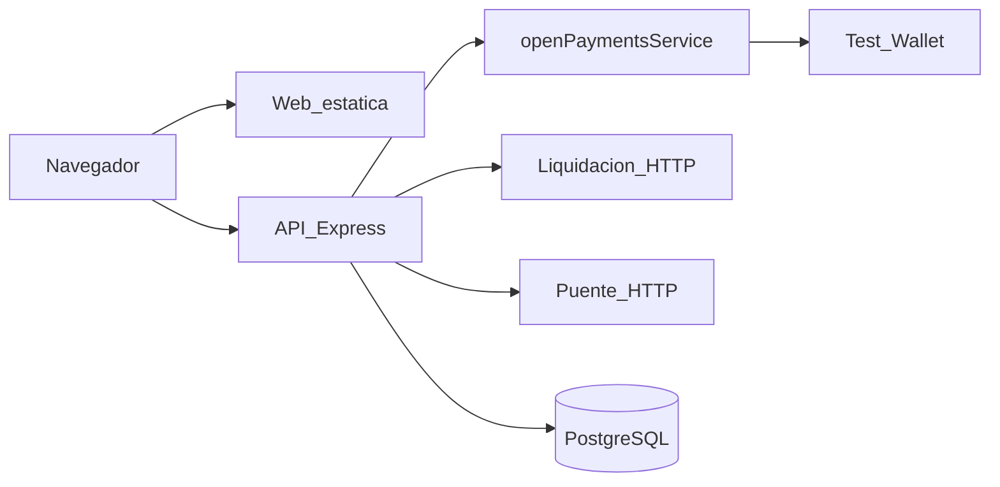

# Especificación de implementación — Tatú

> Documento único para construir Tatú durante el evento. Quien lo lea tiene producto, alcance,
> reglas, modelo, API, pantallas, arquitectura y el orden de implementación. No hace falta ningún
> otro documento para empezar a escribir código.
>
> **Entrega:** repositorio público con todo en `main` el sábado 17 de octubre de 2026 a las 11:00;
> `AI_USAGE.md` y `/prompts`; video y presentación a las 12:00.

---

## 1. Qué es Tatú

Hoy el Estado le gira al operador todo el subsidio antes del ciclo, el operador lo reparte a sus
puntos, la gente tiene una ventana fija para cobrar y lo que no se cobra se reintegra días después.

**Tatú cambia el movimiento de la plata con Open Payments (Interledger):**

1. La entidad aprueba **una sola vez**, en su banco, un permiso con tope. Eso **no mueve dinero**.
2. Cada beneficiario cobra cuando quiere: a su llave Bre-B (o a una wallet Open Payments) o en
   efectivo en un punto, con cédula y PIN.
3. El punto entrega el efectivo y recibe el reembolso **en el mismo momento**. Nunca pone plata
   por adelantado.
4. Lo que nadie cobra **nunca salió** de la cuenta de la entidad.

En Colombia casi nadie tiene una wallet Open Payments, pero sí una **llave Bre-B** (cédula, celular,
correo o @alias). Tatú cobra a esa llave. Tatú sigue hablando solo Open Payments: un **banco puente**
resuelve la llave a una wallet address. En la demo el puente es simulado y se dice así.

Lo que el jurado debe recordar es el movimiento de la plata, no las pantallas.

---

## 2. Alcance

### 2.1 Entra (MVP de la demo)

- Tres roles de producto (entidad, beneficiario, punto) más una pantalla de equipo de prueba.
- Programa de **subsidio** (destino libre): cobro a la cuenta y retiro en punto.
- Programa de **bono** (destino restringido): cobro por compra en un comercio de la categoría
  autorizada.
- Un permiso GNAP con tope, aprobado en la Interledger Test Wallet.
- Pago saliente Open Payments (incoming payment + `debitAmount`, sin cotización).
- Liquidación del gobierno **simulada** (quién cobra, cuánto, PIN).
- Banco puente Bre-B **simulado** (llave → wallet).
- Tablero de la entidad, caja del punto, historial del beneficiario.
- Carga de personas desde Excel o CSV (registro en el equipo).
- Despliegue: web estática + API en una función, mismo dominio, HTTPS.

### 2.2 No entra (recorte explícito)

| Recorte | Por qué | Cómo se dice en el pitch |
|---|---|---|
| Login, CORS, límite de pedidos | El evento dura menos de 24 h; el permiso del banco es la autorización que mueve plata | «Selector de rol; la entidad se autentica en su banco» |
| Tabla `entidad` y aislamiento por NIT | El NIT de la pantalla de entrada solo abre la puerta de la demo | «Una entidad en la demo; en producción hay tabla y RLS» |
| QR, PDF417, contratos, deploy extra | No se ven en el video de 3 minutos | — |
| Carril Bre-B real | No hay API pública del directorio | «El puente es simulado; Tatú solo habla Open Payments» |
| Liquidación real de una entidad | Cada entidad tiene la suya; se consume por HTTP para poder cambiarla | «Consultamos por cédula, no copiamos el padrón» |
| App nativa | La demo cabe en el navegador | — |
| KMS, cifrado de cédulas, fotos de identidad | Fuera del video | — |

El PIN de la entidad en la pantalla de entrada es de demostración: se valida en el navegador. **No
se presenta como control de acceso.** Quien tenga el enlace puede usar la API. La mitigación de la
demo es grabar el video **antes** de abrir el enlace al público.

### 2.3 Criterio de «está listo»

Un pago Open Payments completo y grabado: la entidad autoriza, alguien cobra, el dinero llega, el
tablero lo refleja. Sin eso el resto no se evalúa.

---

## 3. Actores

| Rol | Quién es en la demo | Qué hace |
|---|---|---|
| Entidad | El gobierno (la wallet que paga) | Crea el programa, aprueba el tope en su banco, ve el tablero, pausa, cierra |
| Beneficiario | Quien recibe | Ve cuánto tiene, cobra a su llave o a su wallet, o va a un punto |
| Punto | Un Efecty o un comercio | Digita la cédula, pide el PIN, entrega y ve su caja |
| Equipo | Quien arma la demo | Registra personas, puntos, comercios y llaves Bre-B de prueba |

No hay cuentas de usuario. El rol vive en `localStorage`. Las rutas de beneficiario exigen
`documento`; las de punto, `puntoId`. Las de entidad no se guardan.

**Personas de semilla** (para el guion y las pruebas):

| Nombre | Cédula | PIN | Notas |
|---|---|---|---|
| Ana | 900000001 | 1111 | Una vez el monto |
| Luis | (la del guion) | 2222 | |
| Jorge | (la del guion) | 3333 | |
| Rosa | (la del guion) | 4444 | Dos veces el monto; **novedad**: no entra en el tope |

---

## 4. Requisitos funcionales

Cada historia se acepta cuando el criterio de la columna derecha se puede demostrar en la demo.

### 4.1 Entidad

| ID | Historia | Aceptación |
|---|---|---|
| HU-01 | Crear un programa (nombre, entidad, wallet, vigencia, tipo subsidio o bono, monto por persona, categorías si es bono) | Queda en **Borrador**; la moneda y la escala salen de la wallet, no se teclean |
| HU-02 | Ver cuántas cédulas cubre la liquidación y el tope | `GET /programas/:id/liquidacion` → `{ cedulas, total, moneda }` |
| HU-04 | Autorizar el programa en el banco | Un redirect a la Test Wallet; al volver, el programa queda **Activo** con token y URL de gestión |
| HU-05 | Cancelar una autorización pendiente | El programa vuelve a Borrador; el grant se cancela |
| HU-06 | Si el permiso deja de rotar, renovarlo | «Renovar permiso» pide un grant por lo que falta del tope y conserva lo ya cobrado |
| HU-08 | Tablero: autorizado, cobrado, lo que no ha salido, cobros | Cobrado se lee del permiso (`spentDebitAmount`); si el banco no responde, de lo Pagado en la base, con fuente «plataforma» |
| HU-17 | Pausar y reanudar | Activo ↔ Pausado; en Pausado no se cobra |
| HU-18 | Cerrar el programa | Hay que escribir `CERRAR`; se revoca el grant; lo no cobrado no salió |
| HU-26 | Lista de programas de la entidad | Desde `/entidad` se entra a cada uno según su estado |
| HU-27 | Cargar personas desde Excel o CSV | Plantilla `cedula,nombre,billetera`; se registran en el equipo, no se adhieren al permiso. El tope **no** sube si se cargan después de autorizar |

### 4.2 Beneficiario

| ID | Historia | Aceptación |
|---|---|---|
| HU-08b | Inicio: «tienes $…», vigencia, estado de la cuenta | Una persona puede tener pagos en varios programas |
| HU-07 | Enlazar cuenta | Camino principal: llave Bre-B. Camino avanzado: wallet Open Payments (grant `subject`) |
| HU-09 | Cobrar a la cuenta | Sin PIN. Si no hay cuenta enlazada, se prueba la cédula como llave Bre-B (RN-17). El monto lo pone el servidor |
| HU-13 | Ver dónde cobrar en un punto | Lista de puntos; no inicia cobro |
| HU-21b | Ver dónde usar el bono | Sedes de comercios verificados de las categorías del programa |
| HU-16 | Historial de cobros | |

### 4.3 Punto

| ID | Historia | Aceptación |
|---|---|---|
| HU-10 | Nuevo cobro: cédula → qué se puede pagar hoy en ese punto | |
| HU-11 | Confirmar con PIN de 4 dígitos | 120 s para confirmar; 3 fallos → cobro rechazado y bloqueo 15 min en ese programa |
| HU-12 | El reembolso llega a la wallet del punto | No se entrega efectivo hasta **Pagado** |
| HU-15 | Caja del día: entregado, pendiente | `giradoPorAdelantado` siempre `0` |
| HU-21 | Venta con bono en un punto `compra` | `totalCompra` obligatorio; el monto es `min(valor, total)` |

### 4.4 Equipo de prueba

| ID | Historia | Aceptación |
|---|---|---|
| HU-19 | Entrar eligiendo rol, sin login | NIT + PIN de demo en entidad; cédula en beneficiario; elegir punto |
| HU-20 | Registrar personas, puntos, comercios y llaves Bre-B | Una persona: cédula + wallet **o** `cobraCon: llaveCedula`, PIN opcional de 4 dígitos |
| HU-22 | Ver si los pagos son reales | `/estado`: llave vs jwks, puente responde, no hay tokens falsos |

### 4.5 Pagos Open Payments (el núcleo)

| ID | Historia | Aceptación |
|---|---|---|
| HU-03 | Resolver una wallet (`$…` o `https://…`) a moneda y escala | |
| HU-12b | Pago: incoming payment en el destino y outgoing payment con `debitAmount` | Sin `quoteId` |
| HU-14 | Idempotencia | La misma `llaveIdempotencia` devuelve el cobro ya creado |
| HU-23 | Recuperar cobros en Pagando al arrancar | Si no hay URLs, se dispara el pago otra vez; si hay outgoing, se concilia |
| HU-24 | El token del permiso se rota antes de vencer | Dura ~600 s; se rota cada 240 s y ante un 401/403 |
| HU-25 | Hash del callback GNAP | `base64(sha256(nonce \\n finish_nonce \\n interact_ref \\n grant_url))`; se prueban las 6 variantes de padding y slash |

---

## 5. Reglas de negocio

Los montos son **enteros en unidades mínimas**. `$230.000,00` con escala 2 = `23000000`. Nunca
flotantes. El navegador no manda el monto del cobro: solo `totalCompra` en una compra.

### 5.1 Al solicitar el cobro (`POST /cobros`)

| ID | Regla |
|---|---|
| RN-01 | La cédula tiene un pago disponible en la liquidación de ese programa. Si no está en el padrón, **no se crea fila** y se responde 404 |
| RN-02 | Un solo cobro vivo o pagado por cédula y programa. Lo impone un índice único parcial en la base |
| RN-03 | Subsidio (destino `libre`): canales `cuenta` y `retiro`. Bono (`restringido`): solo `compra` en un comercio **verificado** cuya categoría está en el programa |
| RN-04 | Canal `cuenta`: la cuenta está Verificada y en la **misma moneda y escala** del programa |
| RN-05 | Monto: subsidio = valor completo; bono = `min(valor, totalCompra)` |
| RN-06 | El programa está Activo y dentro de su vigencia. Cerrado → `ProgramaCerrado` |
| RN-07 | Si hay un `bloqueo_pin` vigente para esa persona en ese programa, se rechaza |
| RN-17 | Cobrar a la cuenta sin cuenta enlazada: resolver la cédula como llave Bre-B; si existe, se cobra |
| RN-18 | Antes de pagar una llave Bre-B, volver a resolverla; si la wallet se movió, se actualiza |

El canal se decide así:

- `cuenta`: sin `puntoId`; pasa de Solicitado a **Pagando** (no hay PIN).
- `retiro` / `compra`: exigen `puntoId` del tipo correcto; pasan a **PorConfirmar**.
- `totalCompra` solo en `compra`. Si viene en otro canal, 400.

Si no llega `programaId`, se elige: primero Activo, luego Pausado, luego Cerrado; se filtra por
destino según el canal; el primero con pago disponible.

### 5.2 Al enlazar la cuenta (`POST /cuentas`)

| ID | Regla |
|---|---|
| RN-14 | La persona **elige el tipo** de llave. Nunca se adivina por el formato |
| RN-15 | Llave tipo cédula que coincide con la cédula de la persona: Verificada sola, sin PIN |
| RN-16 | Otro tipo: PIN (si lo tiene) + el puente confirma `pertenece`. Si no, «esa llave no está a tu nombre» |

La wallet Open Payments se verifica con un grant `subject` (o, si `VERIFICACION_CUENTA=simulada`,
queda Verificada de inmediato).

### 5.3 Al confirmar el PIN

| ID | Regla |
|---|---|
| RN-07 | PIN de 4 dígitos, lo valida la liquidación. PIN incorrecto → 422 y se incrementa `intentos_pin`. Al tercero: cobro Rechazado `PinBloqueado` y bloqueo 15 min **en ese programa**. Sin PIN registrado en un retiro → 422 `SinPin` **antes** de crear el cobro |
| RN-12 | PorConfirmar de más de 120 s → Rechazado `TiempoAgotado` (al confirmar, cancelar o consultar) |

### 5.4 Al autorizar y al pagar

| ID | Regla |
|---|---|
| RN-08 | El tope se congela al autorizar: suma de la liquidación **sin novedades**. Quien se registre después no lo sube |
| RN-09 | El tope lo hace cumplir el **banco** (`InsufficientGrant` / 403 en el outgoing payment), no la plataforma |
| RN-10 | Pagado si el outgoing no falló y `sent ≥ debit`, o el incoming está `completed` / `received ≥ expected`. Si no, sigue Pagando |
| RN-11 | Los montos se validan como cadenas de dígitos. El único monto que manda el navegador es `totalCompra` |

Un timeout o un 5xx **durante el pago no marca Fallido**: el cobro se queda en Pagando y se
concilia después. Un timeout al rotar el token **no** marca el permiso vencido.

### 5.5 Motivos de rechazo o fallo

`YaCobrado`, `EnProceso`, `TopeSuperado`, `ProgramaCerrado`, `SinPagoDisponible`,
`CuentaNoVerificada`, `PinBloqueado`, `TiempoAgotado`, `ProgramaNoRecibe`, `LiquidacionNoResponde`,
`PermisoVencido`, `Cancelado`, `ComercioNoAutorizado`, `SoloEnComercios`, `ErrorPago`,
`LlaveNoExiste`, `PuenteNoResponde`.

---

## 6. Máquinas de estados

### 6.1 Programa

```
Borrador → EsperandoAprobacion → Activo ⇄ Pausado → Cerrado
EsperandoAprobacion → Borrador   (rechazo, vencimiento a los 10 min, o cancelar)
Cerrado es terminal
```

Activo y Pausado exigen `token_acceso` y `url_gestion`. Fuera de Borrador no se cambian wallet,
moneda ni escala. La máquina la aplica la aplicación (no hay trigger).

### 6.2 Cobro

```
Solicitado → PorConfirmar | Pagando | Rechazado
PorConfirmar → Pagando | Rechazado
Pagando → Pagado | Fallido
Pagado, Rechazado, Fallido son terminales
```

Nacimiento permitido: Solicitado, PorConfirmar, Rechazado. Un trigger de PostgreSQL rechaza
cualquier otra transición, prohíbe borrar cobros y sube `version` en cada update (bloqueo
optimista: `UPDATE … WHERE id AND version`).

### 6.3 Cuenta del beneficiario

```
SinEnlazar → PorVerificar → Verificada
PorVerificar → SinEnlazar   (si la aprobación vence a los 10 min)
```

Una sola cuenta vigente por persona (índice parcial en PorVerificar y Verificada).

---

## 7. Modelo de datos

Tres esquemas. La API de Tatú **nunca** lee los dos últimos por SQL: los consulta por HTTP, como si
fueran de terceros.

| Esquema | Qué es |
|---|---|
| `piloto` | Tatú: programas, cobros, cuentas, puntos, comercios, eventos |
| `piloto_gobierno` | Liquidación simulada: `persona` (documento, nombre, veces, pin_hash, novedad) |
| `piloto_puente` | Banco puente: `llave` PK `(tipo, valor)` → billetera |

**No hay tabla `entidad`.** `programa.entidad` es un texto de 3 a 80 caracteres.

### 7.1 Tablas de `piloto`

| Tabla | Clave | Campos que importan | Protecciones |
|---|---|---|---|
| `programa` | uuid | entidad, nombre, tipo, destino, billetera, moneda, escala, vigencia, tope, estado, tokens OP, `monto_por_persona`, `permiso_vencido_en`, `gastado_permisos_anteriores` | `destino_segun_tipo`; Activo/Pausado con permiso; tope obligatorio al salir de Borrador |
| `beneficiario` | uuid | `tipo_documento` + `numero_documento` únicos. La app escribe siempre `CC` | documento 3–20 alfanumérico |
| `cuenta_beneficiario` | uuid | billetera, estado, tipo_llave + llave (las dos o ninguna) | una vigente por persona |
| `punto` | uuid | nombre, billetera única, tipo `retiro`/`compra`, `comercio_id` solo si compra | |
| `comercio` | uuid | nit único 5–15 dígitos, ciiu 4 dígitos, categoria, `verificado_en` | sin verificar no acepta bonos |
| `programa_categoria` | (programa, categoria) | alimentos, salud, educación | |
| `programa_punto` | (programa, punto) | reserva; la autorización del bono en este MVP es **por categoría** | |
| `cobro` | uuid | canal, montos, estado, `llave_idempotencia` única, `referencia` `SUB-0001…`, URLs de pago, `version` | ver CHECKs abajo |
| `bloqueo_pin` | (programa, beneficiario) | `bloqueado_hasta`, cobro que lo causó | un candado por persona y programa |
| `evento` | bigserial | tipo_entidad, id, estados, detalle jsonb, actor | solo INSERT. Actor: `sistema\|entidad\|beneficiario\|punto\|banco` opcionalmente `:uuid` |

CHECKs del cobro que no se negocian: `canal_y_cuenta`, `canal_y_punto`, `compra_con_total`,
`monto_si_avanza`, `motivo_si_termina_mal`, `pagado_con_pago_saliente`, `bono_no_supera_compra`,
índice parcial `un_cobro_vivo_por_persona`.

Triggers: transiciones del cobro; no borrar cobros ni eventos; moneda del programa fija fuera de
Borrador; `fn_cobro_reglas` al insertar (RN-06, RN-03, tipo de punto, RN-04 Verificada, RN-07).

RLS se **enciende** en todas las tablas y **no se crean políticas**. La API se conecta con el rol
dueño, que salta RLS. El interruptor queda puesto para cuando exista tabla `entidad`.

Las migraciones son SQL numeradas y se anotan en `piloto.migracion`. Se aplican solas al arrancar.

---

## 8. API

Una app Express bajo `/api`. Cuerpo JSON, tope 20 kb. Respuesta de error:
`{ "error": { "codigo", "mensaje" } }`. Sin autenticación, sin CORS, sin límite de pedidos: la web
y la API comparten origen.

Los montos viajan como **string de dígitos**. Las fechas de vigencia `YYYY-MM-DD` son el día
completo en Bogotá (UTC−5).

### 8.1 Programas

| Método | Ruta | Cuerpo | Qué hace |
|---|---|---|---|
| GET | `/programas` | | Lista; vence autorizaciones de más de 10 min |
| POST | `/programas` | entidad, nombre, billetera, vigenciaInicio/Fin, tipo=`subsidio`, montoPorPersona?, categorias? | Crea Borrador |
| GET | `/programas/:id` | | |
| PATCH | `/programas/:id` | parcial de lo mismo | Solo Borrador |
| GET | `/programas/:id/liquidacion` | | Tope propuesto |
| POST | `/programas/:id/autorizar` | | Grant interactivo; `{ redirect, programa }` |
| GET | `/callback/:id` | query hash, interact_ref, result | Continúa el grant; **302** a la web |
| POST | `/programas/:id/cancelar-aprobacion` | | Vuelve a Borrador |
| POST | `/programas/:id/renovar-permiso` | | Si `permiso_vencido_en` |
| GET | `/programas/:id/tablero` | | |
| POST | `/programas/:id/pausar` \| `/reanudar` | | |
| POST | `/programas/:id/cerrar` | `{ confirmacion: "CERRAR" }` | |
| GET | `/programas/:id/comercios` | | Sedes autorizadas del bono |

### 8.2 Personas y cuentas

| Método | Ruta | Cuerpo | Qué hace |
|---|---|---|---|
| GET | `/beneficiarios/demo` | | Nombre y cédula para el selector |
| GET | `/beneficiarios` | | Equipo: wallet y si tiene PIN |
| POST | `/beneficiarios` | documento `^\d{5,12}$`, **billetera** (min 3) **o** `cobraCon: llaveCedula`, nombre?, pin `^\d{4}$`? | Inscribe en liquidación; opcionalmente registra la cédula como llave; deja cuenta Verificada si trajo wallet |
| POST | `/beneficiarios/:documento/pin` | `{ pin }` | |
| GET | `/beneficiarios/:documento/resumen` | | pagos[], cuenta, historial |
| POST | `/cuentas` | `{documento,tipoLlave,llave,pin?}` **o** `{documento,billetera,pin?}` | |
| GET | `/cuentas/llaves/:tipo/:valor` | | Titular enmascarado |
| GET | `/cuentas/callback/:id` | | 302 a `/beneficiario/cuenta?resultado=` |
| GET | `/cuentas/:documento` | | |

La carga Excel llama `POST /beneficiarios` una vez por fila. Cada fila necesita cédula, nombre y
wallet (o se registra con `cobraCon: llaveCedula`). El `valor` del archivo **no** se guarda: el
monto lo define `programa.monto_por_persona`.

### 8.3 Cobros y puntos

| Método | Ruta | Cuerpo | Qué hace |
|---|---|---|---|
| POST | `/cobros` | documento, canal, llaveIdempotencia 8–100, programaId?, puntoId?, totalCompra? | 201 |
| POST | `/cobros/:id/confirmar` | `{ pin }` | 202 si pasa a Pagando |
| POST | `/cobros/:id/cancelar` | | |
| GET | `/cobros/:id` | | Aplica RN-12; si Pagando, concilia |
| GET | `/billeteras/resolver?direccion=` | | |
| GET / POST | `/puntos` | nombre, billetera, tipo=`retiro`, programaId? | |
| GET | `/puntos/:id/pagos?documento=` | | Qué se puede pagar hoy |
| GET | `/puntos/:id/cobros?desde=` | `hoy` \| `7d` \| `todo` | |
| GET | `/puntos/:id/resumen?desde=` | default `hoy` | Caja |

### 8.4 Comercios, puente, salud

| Método | Ruta | Qué hace |
|---|---|---|
| GET | `/categorias` | alimentos, salud, educación + CIIU |
| GET / POST | `/comercios` | Comercio + primera sede |
| POST | `/comercios/:id/sedes` | |
| POST | `/comercios/:id/verificar` | Pone `verificado_en` (simula RUT/RUES) |
| GET | `/puente/llaves?documento=` | |
| POST | `/puente/llaves` | tipo, valor, documentoTitular, nombreTitular, billetera |
| DELETE | `/puente/llaves/:tipo/:valor` | |
| GET | `/salud` | Base, llave vs jwks; 200/503 |
| GET | `/estado` | `pagosReales`, puente, tokens falsos. Siempre 200 |
| GET | `/config` | extras, TTL, poll. **Sin secretos** |
| GET | `/openapi.json` y `/docs` | OpenAPI 3.1; el test falla si una ruta montada no está documentada |

El catálogo documentado son **52** rutas de producto. OpenAPI y Swagger van aparte.

---

## 9. Arquitectura

Monolito modular. Una app Node. En local es un proceso; en Vercel es una función que puede tener
varias instancias. Microservicios y colas no entran.



### 9.1 Módulos de la API (`server/src/`)

| Módulo | Decide | Habla con |
|---|---|---|
| `programas/` | Estados del programa, grant, rotación, tablero, cierre | OP + liquidación + DB |
| `cobros/` | Reglas, transiciones, orquestación del pago | OP + liquidación + puente + DB |
| `beneficiarios/`, `cuentas/` | Padrón local y enlace de cuenta | liquidación + puente + OP |
| `puntos/`, `comercios/` | Caja y bonos | OP (resolver wallet) + DB |
| `liquidacion/` | Simula el gobierno | Solo su esquema, por su propio router |
| `puente/` | Simula el banco Bre-B | Solo su esquema |
| `openPaymentsService.ts` | **Único** import del SDK | Test Wallet |
| `db/` | Drizzle, repositorios, migraciones, `AsyncLocalStorage` para la transacción | PostgreSQL |
| `vercel.ts` / `main.ts` | Arranque | |

Las rutas reciben y validan (Zod). `programas/servicio` y `cobros/orquestacion` deciden. Tres
adaptadores salen: Open Payments, liquidación, puente. El núcleo puro —sin red ni base— vive en
`cobros/estados.ts`, `cobros/reglas.ts` y `programas/estados.ts`.

### 9.2 Saga del cobro (punto de no retorno)

No hay transacción común con el banco. El cobro se guarda en **Pagando antes** de crear el pago
saliente. Antes de Pagando no se movió dinero; después no hay rollback, solo consulta.

1. Validar reglas y crear el cobro (Solicitado → PorConfirmar o Pagando).
2. Responder 201/202 al navegador.
3. Seguir el pago en segundo plano (`waitUntil` en Vercel, para que la función no se congele).
4. Si no hay incoming: grant no interactivo (se cachea por wallet destino) y `incomingPayment.create`.
   **Guardar la URL antes** de crear el outgoing.
5. Outgoing: `incomingPayment` + `debitAmount` (forma B, sin quote). Luego RN-10.
6. Errores: `PermisoVencido` / `TopeSuperado` / otro `ErrorOP` → Fallido. `SinRespuesta` → se queda
   Pagando.
7. Al consultar o al arrancar: conciliar. Si está Pagando y no hay ninguna URL, disparar otra vez.

El estado avanza al crear, en el callback y al consultar. No hay worker. Los 120 s del PIN se
evalúan al consultar.

### 9.3 Permiso del programa

1. `grant.request` interactivo: acciones `create,read` de outgoing-payment, `limits.debitAmount` =
   tope, `finish.uri = API_BASE_URL/callback/:id`, nonce UUID.
2. El banco redirige al callback. Se verifica el hash (HU-25) y se hace `grant.continue`.
3. El token dura ~600 s. Cada 240 s, y ante 401/403, se rota (`token.rotate`).
4. Si la rotación pierde (otro proceso ya rotó: `invalid access token`), **releer la base antes de
   marcar vencido**. Marcar `permiso_vencido_en` solo si el token no cambió. Rotar dentro de
   `SELECT … FOR UPDATE` sobre la fila del programa: el candado de sesión
   (`pg_try_advisory_lock`) **no sirve** en el pooler de Supabase puerto 6543 (modo Transaction).
5. Cerrar: `token.revoke`. Cancelar pendiente: `grant.cancel`.

### 9.4 Liquidación y puente (contratos HTTP)

La API los trata como servicios ajenos. En la demo corren en la misma app (`/api/liquidacion`,
`/api/puente`) y se alcanzan por `LIQUIDACION_URL` y `PUENTE_URL`.

**Liquidación:** resumen del programa; pago por cédula; validar PIN (scrypt; cuerpo inválido →
`{valido:false}`, no 400); listar nombres; inscribir; poner PIN. El monto =
`(monto_por_persona ?? 23000000) * veces`. Las novedades no entran en el tope y sí pueden cobrar.

**Puente:** resolver llave; `pertenece(documento)`; CRUD de llaves. Normalización: cédula sin
puntos; celular colombiano `3` + 9 dígitos; correo en minúsculas; alias `@[a-z0-9._-]{2,30}`.
Cédula como tipo exige `valor = documentoTitular`. Nombres y valores se enmascaran al responder.

Si `LIQUIDACION_SIMULAR_FALLA` o `PUENTE_SIMULAR_FALLA`, esas rutas responden 503.

### 9.5 Front

React 19 + Vite + Tailwind 4 + shadcn/ui. El navegador **nunca** habla con Open Payments. Llama
`/api`. En local, Vite (puerto 5173, `strictPort`) hace de proxy a la API (3000, o `API_PROXY`).

**Pantallas:**

| Ruta | Rol | Pantalla |
|---|---|---|
| `/` | entrada | Elegir rol |
| `/entrar/entidad` | entidad | NIT (forma `8–10 dígitos-DV`) + PIN de 6 dígitos de demo |
| `/entrar/beneficiario` | beneficiario | Cédula contra `/beneficiarios/demo` |
| `/entrar/punto` | punto | Elegir punto |
| `/entidad` | entidad | Lista y KPIs |
| `/entidad/programas/nuevo` y `…/:id/editar` | entidad | Alta / edición de Borrador |
| `/entidad/programas/:id/aprobar` | entidad | Redirect al banco; poll 2 s, tope 10 min |
| `/entidad/programas/:id` | entidad | Tablero, o redirige según estado |
| `/entidad/programas/:id/beneficiarios` y `…/excel` | entidad | Padrón y carga |
| `/entidad/programas/:id/cerrar` | entidad | Escribir `CERRAR` |
| `/entidad/cobros/:id` | entidad | Detalle |
| `/beneficiario` | beneficiario | Inicio |
| `/beneficiario/cuenta` | beneficiario | Enlazar llave o wallet |
| `/beneficiario/cobrar` | beneficiario | Un botón, sin PIN |
| `/beneficiario/cobros/:id` | beneficiario | Espera → pagado |
| `/beneficiario/puntos` | beneficiario | Dónde cobrar |
| `/beneficiario/bono/:programaId` | beneficiario | Dónde usar el bono |
| `/beneficiario/historial` | beneficiario | |
| `/punto` | punto | Inicio + cobro (retiro) o venta (compra) |
| `/punto/caja` | punto | Misma caja |
| `/punto/cobros/:id` | punto | PIN → espera → pagado |
| `/equipo`, `/estado` | equipo | Armar la demo y ver si se paga de verdad |

Identidad: Arena `#F5F0E6`, Noche `#13203A`, Azul `#2E5FE0`, Ámbar `#F6A623`. Fuentes Archivo
Variable + IBM Plex Mono. Modo oscuro con `data-tema` y `localStorage tatu.tema`. En los pagos, el
tatú se enrolla (`prefers-reduced-motion` se respeta). Poll del cobro: 1 s; tablero: 5 s; caja: 10 s.

Modo `simulada` (Vite `--mode simulada`): la API vive en el navegador. **No se despliega.** Sirve
para diseñar pantallas sin Test Wallet.

---

## 10. Requisitos no funcionales

| ID | Requisito |
|---|---|
| RNF-01 | Secretos solo en variables de entorno. Nunca en el repo ni en `/config` ni en OpenAPI |
| RNF-02 | HTTPS en el despliegue; mismo origen web + API |
| RNF-03 | El navegador no firma ni guarda tokens de Open Payments |
| RNF-04 | Tokens del permiso y noces no salen en las respuestas JSON |
| RNF-05 | Una operación de cobro (hasta Pagando) responde en menos de 5 s percibidos; el pago sigue en segundo plano |
| RNF-06 | El estado del cobro se consulta cada 1 s y alcanza |
| RNF-07 | El núcleo de reglas se prueba con tabla de casos, sin red |
| RNF-08 | Las 52 rutas montadas = las documentadas en OpenAPI. El test lo exige |
| RNF-09 | Typecheck y la suite en verde antes de desplegar |
| RNF-10 | Idempotencia del cobro en la base, no solo en memoria |
| RNF-11 | Ante un 401 del token: un reintento después de rotar, no un bucle |
| RNF-12 | Logs sin PIN, token, nonce, hash ni `interact_ref` |

---

## 11. Stack y despliegue

| Pieza | Elección | Motivo |
|---|---|---|
| Runtime | Node 24, pnpm 12.9.1, workspace `web` + `api` | Una sola herramienta |
| API | Express 5, tsx, Zod 4 | Rápido de escribir; el cuerpo se valida en el borde |
| Web | React 19, Vite, Tailwind 4, shadcn/ui | |
| Pagos | `@interledger/open-payments` **7.4.0** fijado | La Test Wallet habla esta versión |
| Datos | PostgreSQL (Supabase pooler). Drizzle. Migraciones SQL | UNIQUE parcial, triggers, `FOR UPDATE` |
| Local sin internet | PGlite (`DATABASE_URL=pglite:./data/pglite`) | El mismo SQL |
| Host | Vercel: estáticos + **una** función Node 24 que atiende todo `/api`, `maxDuration` 60 s, Build Output API v3 | Un dominio, HTTPS, sin Docker |

En Vercel no hay proceso prendido. El primer pedido de cada instancia abre la base, migra y
recupera cobros en Pagando. La renovación de tokens se dispara con los pedidos. Las tareas de
fondo se cortan a los 45 s.

Pooler: en Vercel puerto **6543** (Transaction) y `prepare: false`. En local, 5432 (Session). El
candado de rotación es de **fila** (`SELECT … FOR UPDATE`), no de sesión.

---

## 12. Variables de entorno

| Variable | Default | Uso |
|---|---|---|
| `PORT` | 3000 | |
| `APP_BASE_URL` | obligatoria | Redirects del callback |
| `API_BASE_URL` | obligatoria | `finish.uri` del grant |
| `LIQUIDACION_URL` | obligatoria | Gobierno |
| `PUENTE_URL` | `${API}/puente` | Banco puente |
| `DATABASE_URL` | `pglite:./data/pglite` | Postgres o PGlite |
| `OP_CLIENT_WALLET_ADDRESS` | | Wallet que firma |
| `OP_KEY_ID` | | |
| `OP_PRIVATE_KEY_BASE64` **xor** `OP_PRIVATE_KEY_PATH` | | Ed25519 |
| `CONFIRMACION_TTL_SEG` | 120 | |
| `PIN_MAX_INTENTOS` | 3 | |
| `PIN_BLOQUEO_MIN` | 15 | |
| `POLL_INTERVALO_MS` | 1000 | |
| `APROBACION_TTL_MIN` | 10 | Grant y verificación de cuenta |
| `TOKEN_RENOVAR_CADA_SEG` | 240 | El token dura ~600 s |
| `VERIFICACION_CUENTA` | `subject` | o `simulada` |
| `LIQUIDACION_MONTO_BASE` | `23000000` | |
| `LIQUIDACION_SIMULAR_FALLA` / `PUENTE_SIMULAR_FALLA` | false | |
| `EXTRA_BONO` | false | Si es false, la UI no ofrece crear un bono; el backend sí lo sirve |
| `DEMO_WALLET_*` | | Solo la semilla |

En Vercel, si faltan `APP_BASE_URL`, `API_BASE_URL` o `LIQUIDACION_URL`, se completan con el
dominio del despliegue. `db:reset` borra los tres esquemas del piloto **sin preguntar**: no apuntar
`DATABASE_URL` de producción desde el portátil.

---

## 13. Orden de implementación

El evento son unas 8,75 h en sitio más la noche del viernes. El criterio: **el sábado a las 11:00
hay un pago grabado**. Si a las 14:00 del viernes no hay cobro Pagado, se suelta lo demás.

### Sesión 1 — Viernes mañana (el pago)

1. Repo, `.gitignore`, `AI_USAGE.md` vacío, carpeta `/prompts`, workspace pnpm, Node 24.
2. `config.ts` + `.env.example`. Conexión PGlite y Postgres. Migración 001: enums, `programa`,
   `beneficiario`, `cobro` con CHECKs, triggers de transición, `evento`.
3. `openPaymentsService.ts`: wallet GET, grant del programa, continue, rotate, incoming, outgoing.
4. Script de un cobro (callback local en 3001) hasta Pagado en la Test Wallet.
5. Liquidación mínima: inscribir, pago por cédula, validar PIN.
6. `POST /programas`, autorizar, callback, `POST /cobros` canal cuenta.

**Puerta:** un cobro Pagado contra la Test Wallet, aunque sea por script.

### Sesión 2 — Viernes tarde (la app)

7. Máquina de programas y tablero. Pausar, reanudar, cerrar.
8. Beneficiario: resumen, enlazar wallet, cobrar a la cuenta. Poll 1 s + tatú.
9. Punto: cédula, PIN, caja. Canal retiro.
10. Selector de rol. Equipo de prueba. `/estado`.
11. Front de entidad: lista, alta, aprobar, tablero.
12. Despliegue en Vercel + Supabase (pooler 6543). `GET /api/salud` en verde.

### Noche del viernes

13. Puente Bre-B y RN-14 a RN-18. Cobrar a la cédula sin enlazar.
14. Rotación del token con `SELECT … FOR UPDATE`. Renovar permiso.
15. Recuperación de Pagando al arrancar. `waitUntil`.
16. Carga Excel (contrato de § 8.2). Bonos si `EXTRA_BONO` y hay tiempo.
17. OpenAPI + test de paridad. Suite de reglas. `typecheck`.

### Sesión 3 — Sábado 08:00–11:00

18. Solo correcciones. Un programa limpio. Video: autorizar → cobrar → Pagado → tablero.
19. Todo en `main`. `AI_USAGE.md` y `/prompts` con los prompts reales. Enlace en el formulario.

---

## 14. Guion de la demo (el video)

Un solo programa, un solo navegador, nadie más contra esa base mientras se graba.

1. Equipo: registrar a Ana (cédula + wallet o llave cédula) y un punto de retiro.
2. Entidad: crear el programa, calcular liquidación, autorizar en la Test Wallet.
3. Beneficiario: entrar con la cédula de Ana, cobrar a la cuenta (un botón).
4. Esperar Pagado. Mostrar referencia.
5. Tablero: cobrado > 0, el cobro en la tabla.
6. (Si alcanza) Punto: otra persona, cédula + PIN, «tu reembolso ya llegó».

No decir «PIN cifrado» ni «la API está protegida». Sí: «la entidad autoriza en su banco; Tatú no
toca la plata hasta que alguien cobra».

---

## 15. Árbol del repositorio

```
/
  package.json              pnpm workspace, build:vercel
  pnpm-lock.yaml
  vercel.json               install --frozen-lockfile + build:vercel
  scripts/build-vercel.mjs  estáticos + functions/api.func
  .env.example
  AI_USAGE.md
  prompts/<rol>.md
  web/                      React + Vite
  server/                   paquete "api"
    src/main.ts
    src/vercel.ts
    src/app.ts
    src/config.ts
    src/openPaymentsService.ts
    src/openapi.ts
    src/{programas,cobros,beneficiarios,cuentas,puntos,comercios,liquidacion,puente,db}/
  docs/                     este archivo y el resto
```

Comandos: `pnpm dev` (API 3000 + web 5173), `pnpm -r test`, `pnpm -r typecheck`,
`pnpm run build:vercel`.

---

## 16. Cómo se escala (para el pitch, no para el evento)

El diseño ya deja el gancho:

1. Tabla `entidad` y clave foránea desde `programa`. Hoy `entidad` es un texto: no hay dónde
   colgar un login.
2. Invertir la persistencia: la orquestación recibe puertos, no importa repositorios. El núcleo
   (`estados`, `reglas`) ya es puro.
3. Políticas RLS por entidad. El interruptor ya está puesto.
4. Autenticación, CORS y tope de pedidos: un middleware, cuando exista el sujeto.
5. Liquidación y puente ya se consumen por HTTP: sustituir el simulado es cambiar la URL.
6. Un segundo adaptador de pagos, cuando salgamos de la Test Wallet.

No hacen falta microservicios: los módulos ya están separados por agregado y comparten una base
transaccional. El detalle está en
[Plan de escalado — de monolito modular a hexagonal](./Plan%20de%20escalado%20—%20de%20monolito%20modular%20a%20hexagonal.md).
